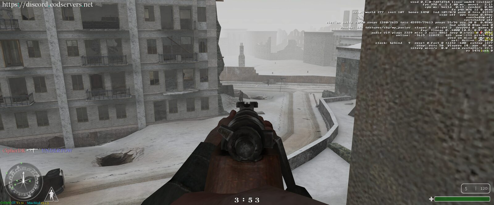
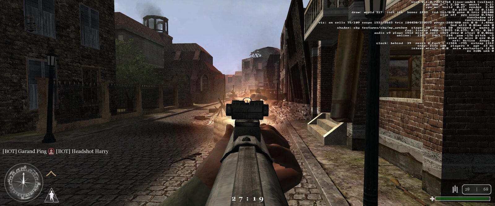
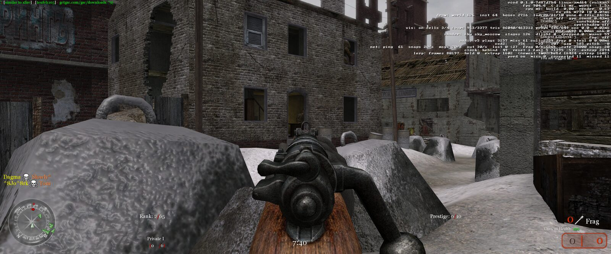
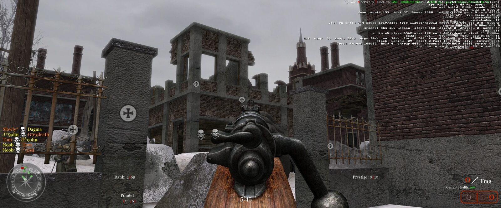
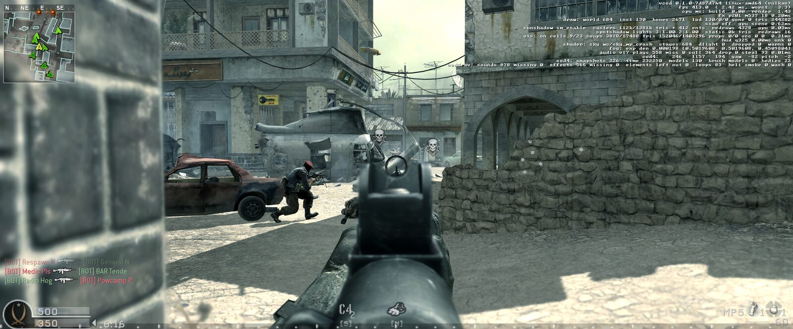
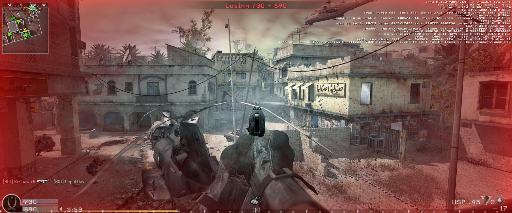

# Screenshots

All six are 3840x1600 (21:9) with the F3 overlay up, taken on the
2026-10-31 build. Click a shot for the full-resolution image.

## Call of Duty

mp_pavlov on a public server.

## United Offensive

mp_uo_stanjel against bots.

## Call of Duty 2

mp_leningrad on a public server.

## Call of Duty 4

mp_crash against bots.

`tools/screenshots.sh` builds the JPEGs, thumbnails and the README collage
from the PNGs.
