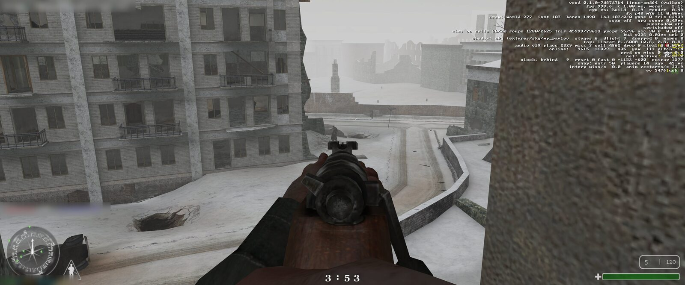
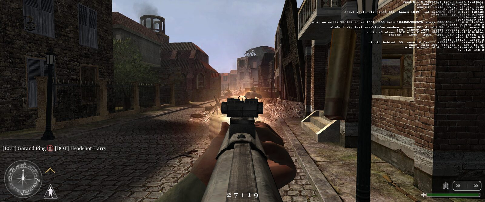
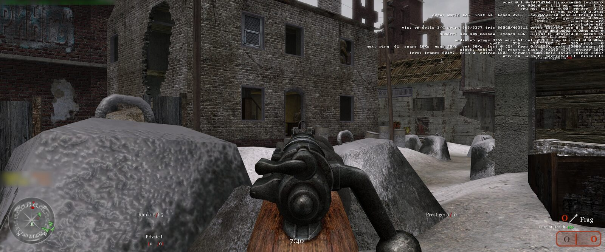
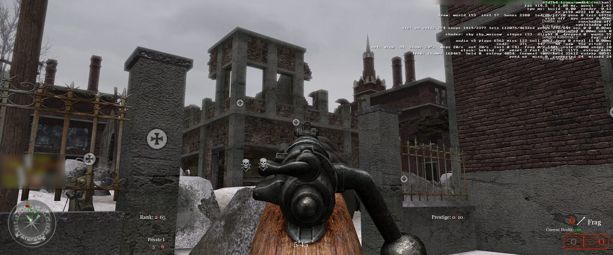
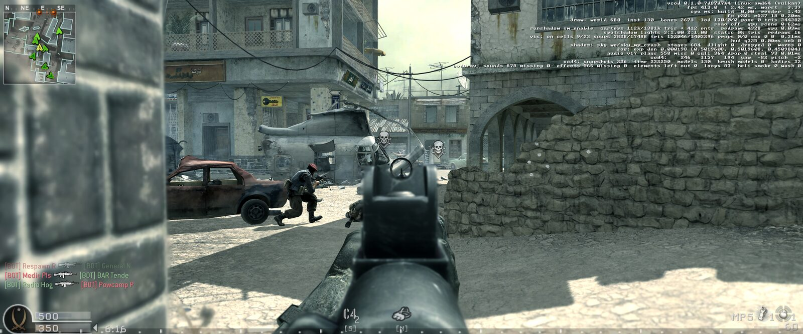
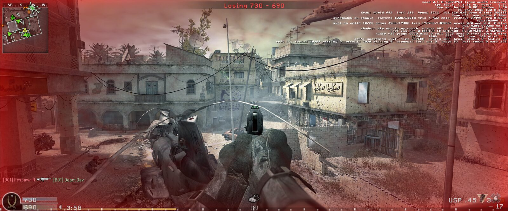

# Screenshots

All six are 3840x1600 (21:9) with the F3 overlay up, taken on the
2026-10-31 build. Click a shot for the full-resolution image.

## Call of Duty

mp_pavlov on a public server; the other players' names and the server's
own text are blurred.

## United Offensive

mp_uo_stanjel against bots.

## Call of Duty 2

mp_leningrad on a public server; the other players' names and the
server's own text are blurred.

## Call of Duty 4

mp_crash against bots.

`tools/screenshots.sh` builds the JPEGs, thumbnails and the README collage
from the PNGs. Only the thumbnails and the collage live in the tree; the
full-size JPEGs are assets of the `screenshots` release, uploaded with the
`gh release upload` command the script prints. A shot from a public server needs the kill feed and the
server's banners blurred first; shots against bots do not.
